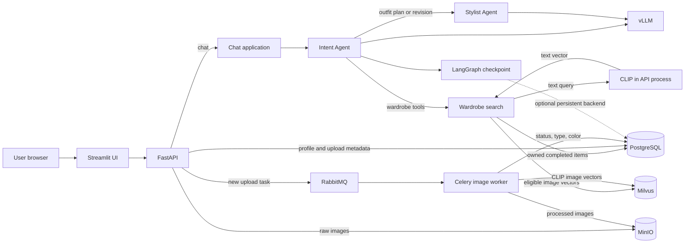

# Fashion Agent

A wardrobe-aware fashion assistant with a Streamlit UI and FastAPI backend. An
Intent Agent handles conversation and revisions; a Stylist Agent plans outfits
using the user's processed clothing uploads. Search loads the user's inventory
from PostgreSQL, embeds outfit descriptions with CLIP, matches image vectors in
Milvus, and ranks compatible garments.

## Table of Content

- [Repo Structure](#repo-structure)
- [System Architecture Design](#system-architecture-design)
- [Run locally](#run-locally)
- [Test](#test)
- [Logs and traces](#logs-and-traces)
- [Sharing the UI](#sharing-the-ui)

## Repo Structure

```text
.
├── agent/
│   ├── agents/
│   │   ├── chat/                   # Chat turn and response handling
│   │   ├── intent/                 # Intent Agent, tools, and conversation state
│   │   ├── stylist/                # Stylist Agent and outfit schemas
│   │   └── skills/fashion_styling/ # Styling instructions
│   ├── search/                     # Active wardrobe retrieval and CLIP queries
│   ├── search_tool/                # Separate catalog search helpers
│   ├── persistence/                # LangGraph checkpoint backends
│   └── observability/              # Logs, traces, metrics, dashboards
├── api/                            # FastAPI profile, wardrobe, and chat routes
├── inference/image_inference/      # Celery image-processing worker
├── storage/
│   ├── raw_data/                   # Profile and raw image writes
│   ├── processing/                 # Processed image and embedding writes
│   └── setup/                      # PostgreSQL, MinIO, and Milvus initializer
├── ui/                             # Streamlit app and UI tests
├── tests/                          # Backend unit and integration tests
├── .github/workflows/              # CI checks
├── docker-compose.yml              # Local infrastructure and worker
└── pyproject.toml                   # API dependencies and test configuration
```

The active chat path uses `agent/search/wardrobe.py` to match the user's own
uploads. `agent/search_tool/` contains separate catalog search helpers.

## System Architecture Design



**Upload path:** The API stores the original image in MinIO, creates its
PostgreSQL record, and queues processing through RabbitMQ. The Celery worker
extracts garment details, stores a processed image and CLIP image vector, and
marks the item complete. Only completed items are eligible for chat search.

**Outfit path:** The Intent Agent loads the user's completed wardrobe before
calling the Stylist Agent. Search loads owned completed items from PostgreSQL,
filters them by garment category and explicit constraints, creates a CLIP text
vector in the API process, queries the eligible Milvus vectors, and reranks the
results. Category compatibility and a configurable similarity floor prevent
irrelevant matches; an item can return no match. Outfit revisions can reuse
unchanged matches and selected items.

**Conversation state:** LangGraph checkpoints use a
`<user_id>::<thread_id>` key. The default checkpointer is in memory; a
PostgreSQL backend can be configured for persistence across API restarts. The
`product_matches` API field retains its historical name but contains matches
from the user's uploaded wardrobe.

**Observability:** The API and worker emit structured logs with correlation
IDs. LangSmith can trace agent and tool calls; optional OpenTelemetry exports
service traces and metrics. See [observability setup](agent/observability/README.md).

### Services

| Service | Purpose |
| --- | --- |
| Streamlit | Profile, wardrobe upload, and chat UI |
| FastAPI | Profile, wardrobe, and chat endpoints |
| PostgreSQL | User profiles, wardrobe metadata, and optional chat checkpoints |
| MinIO | Original and processed clothing images |
| Milvus | CLIP vectors for processed clothing images |
| RabbitMQ + Celery | Background processing for new image uploads |
| vLLM | Local model for the Intent and Stylist Agents |

Chat search embeds text in the API process, so it can search completed uploads
even when the image worker is stopped. New uploads still need RabbitMQ and the
worker. The first search may download and load the CLIP model.

## Run locally

Use Python 3.11, [uv](https://docs.astral.sh/uv/), Docker Compose, and a vLLM
server configured to serve `fashion-llm`. Run the commands below from the
repository root.

1. Create your local configuration:

   ```bash
   cp storage/.env.example storage/.env
   ```

   The bundled Compose file currently uses `postgres` as the PostgreSQL
   password and `miniosecret` as the MinIO password. Set
   `POSTGRES_PASSWORD=postgres` and `MINIO_ROOT_PASSWORD=miniosecret` in
   `storage/.env` to match it. Keep this file private; it is Git ignored.
   Set `VLLM_HOST`, `VLLM_PORT`, and `VLLM_MODEL` to match your model server.

2. Start storage and the upload queue:

   ```bash
   docker-compose --env-file storage/.env up -d postgres minio etcd milvus rabbitmq
   ```

3. Initialize a new database and start the image worker:

   ```bash
   uv run --project storage --env-file storage/.env python -m storage.setup
   docker-compose --env-file storage/.env up -d --build celery-worker
   ```

   The initializer is idempotent. It creates the PostgreSQL tables, MinIO
   bucket, and Milvus `image_features` collection.

4. Start the API and UI in separate terminals:

   ```bash
   uv run --project . --with-editable ./agent --env-file storage/.env python -m api.app
   ```

   ```bash
   uv run --project ui --env-file storage/.env streamlit run ui/streamlit_app.py
   ```

   Open <http://127.0.0.1:8501>. The API runs at
   <http://127.0.0.1:8002>; `GET /health` checks its status. Start the
   configured vLLM server before sending a chat message. In the UI, enter a
   stable User ID, create a profile, upload clothing, wait for processing to
   complete, and then chat. For a sample vLLM command and API examples, see
   [storage setup](storage/README.md). For UI usage, see [UI setup](ui/README.md).

## Test

```bash
uv sync --locked
uv run --locked --no-sync pytest -q tests/unit
uv run --locked --no-sync ruff check agent api storage inference ui/streamlit_app.py ui/config.py ui/tests tests
uv sync --locked --project ui
uv run --locked --no-sync --project ui python -m unittest discover -s ui/tests -p 'test_*.py'
```

The [CI workflow](.github/workflows/ci.yml) runs these backend and Streamlit
checks on pushes and pull requests. Live service integration tests are opt-in.

## Logs and traces

API logs appear in its terminal. Follow the image worker with:

```bash
docker-compose --env-file storage/.env logs -f --tail=100 celery-worker
```

See [observability setup](agent/observability/README.md) for LangSmith,
OpenTelemetry, Jaeger, Prometheus, and Grafana.

## Sharing the UI

For a private demo, keep the API and storage bound to `127.0.0.1` and tunnel
only Streamlit's port `8501` through ngrok with an authentication policy. The
Streamlit sidebar's API URL should remain `http://127.0.0.1:8002`, because
Streamlit makes API requests from the host machine.

After installing ngrok and adding your authtoken, create
`~/ngrok-fashion-policy.yml` with a strong password:

```yaml
on_http_request:
  - actions:
      - type: basic-auth
        config:
          credentials:
            - "demo:REPLACE_WITH_A_LONG_PASSWORD"
          enforce: true
```

```bash
chmod 600 ~/ngrok-fashion-policy.yml
ngrok http 8501 --traffic-policy-file ~/ngrok-fashion-policy.yml
```

See [ngrok's setup](https://ngrok.com/download/mac-os) and
[authentication policy example](https://ngrok.com/docs/gateway/examples/ollama).

The current API trusts the caller-supplied `X-User-ID`, and the UI lets a visitor
edit both User ID and API URL. This is suitable only for a trusted, single-user
demo behind an access gate. Multi-user public access requires server-enforced
authentication and ownership checks.
